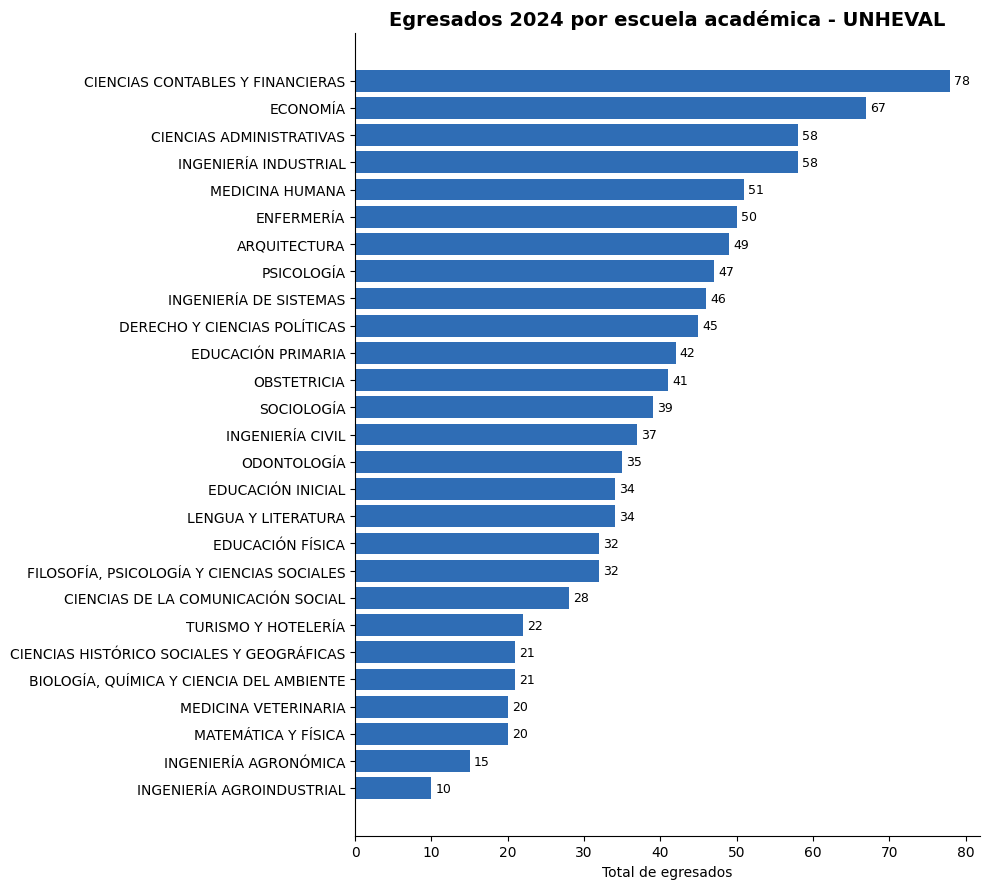
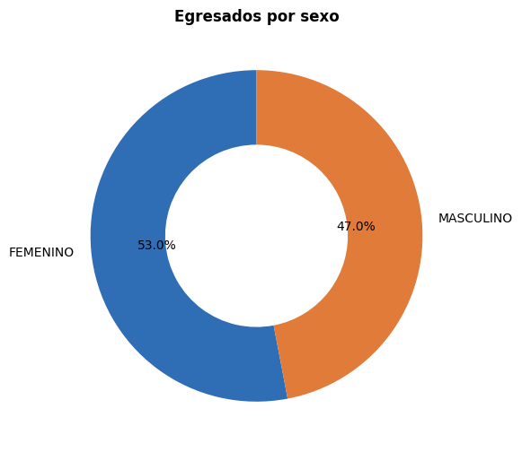
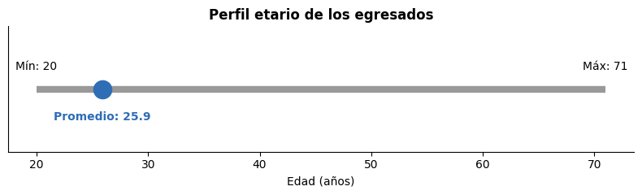
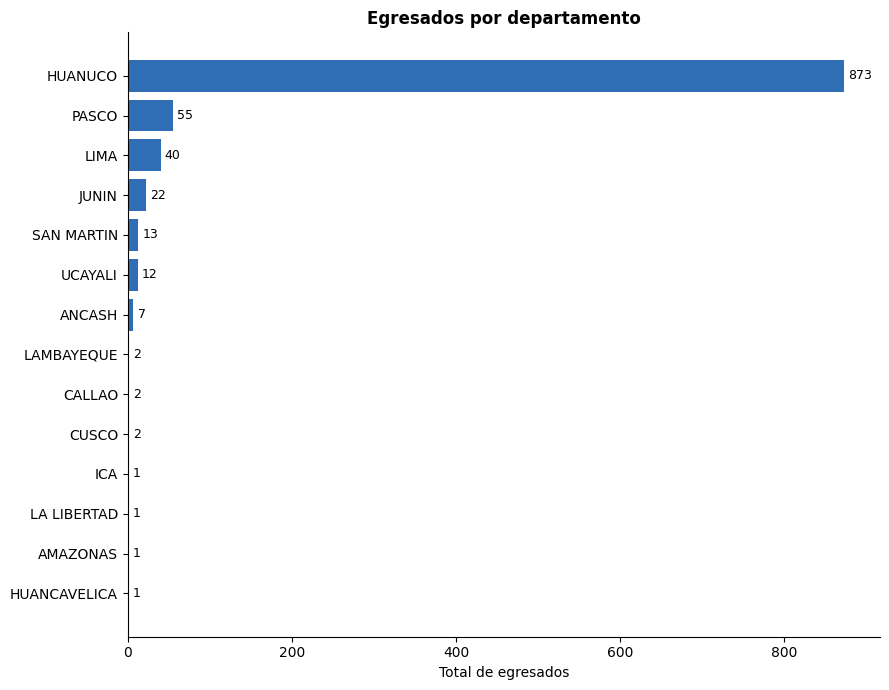
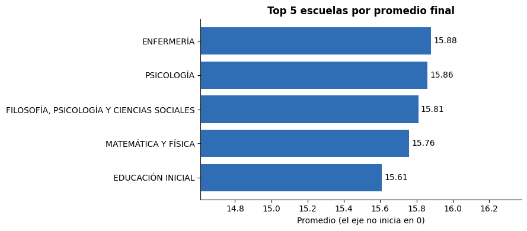
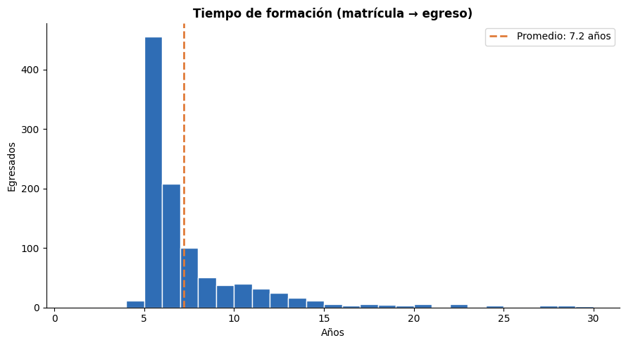
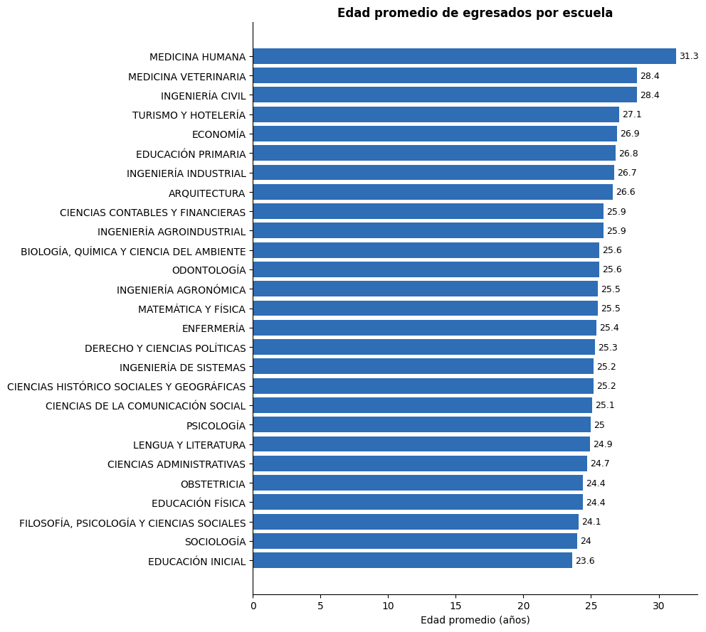
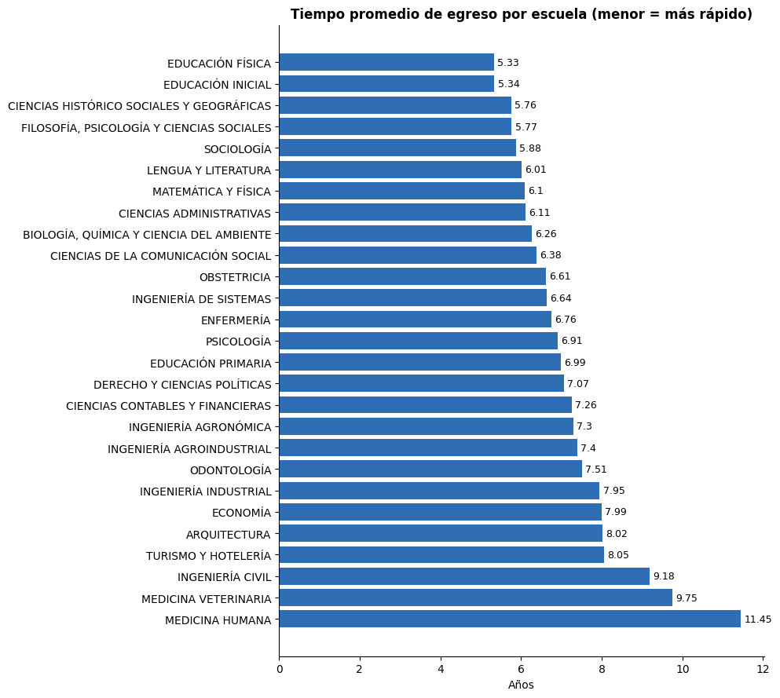
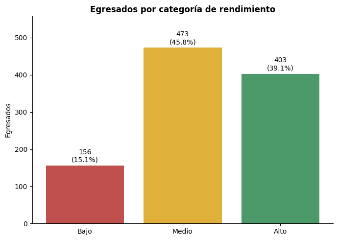
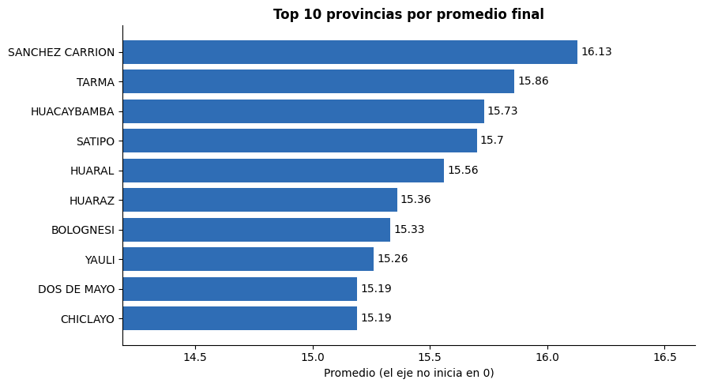

# Proyecto SQL: 🎓 Análisis Académico de Egresados - Rendimiento y Trayectoria Universitaria

## 📌 Resumen (Overview)
*Este proyecto tiene como objetivo analizar la información académica y demográfica de **los egresados de pregrado de la Universidad Nacional Hermilio Valdizán (UNHEVAL) durante el año 2024**.*

_A partir de un dataset anonimizado de egresados, se desarrolló un proceso de análisis utilizando SQL y un modelo dimensional tipo estrella para explorar indicadores relacionados con el perfil de los estudiantes, su rendimiento académico, procedencia geográfica, modalidad de estudios y trayectoria universitaria._

_El análisis busca transformar datos académicos en información útil para la toma de decisiones, permitiendo identificar patrones en el desempeño de los egresados, comparar resultados entre escuelas académicas y modalidades de estudio, así como analizar el tiempo transcurrido desde la primera matrícula hasta el egreso._

_Como parte del proyecto, se diseñaron consultas SQL de complejidad progresiva que incorporan técnicas como **agregaciones, JOINs, CASE WHEN, CTEs y Window Functions** para responder preguntas de negocio relevantes dentro del contexto de la educación superior._

_El resultado es un análisis estructurado que permite generar insights sobre rendimiento académico, eficiencia en la trayectoria formativa y características de la población de egresados._

## 🎯 Objetivo de negocio
Analizar la información académica y demográfica de los egresados de pregrado de la Universidad Nacional Hermilio Valdizán durante el año 2024, con el propósito de identificar patrones de rendimiento académico, trayectoria universitaria, procedencia geográfica y eficiencia en el tiempo de formación que contribuyan a la toma de decisiones institucionales.

## 🎯 Objetivos específicos
1. Analizar la distribución de egresados según escuela académica, sexo, modalidad de estudio y sede.
2. Identificar el perfil demográfico y geográfico de los egresados.
3. Evaluar el rendimiento académico mediante el análisis del promedio final por diferentes dimensiones.
4. Comparar el desempeño académico entre escuelas académicas y modalidades de estudio.
5. Analizar las cohortes de ingreso según el año y semestre de primera matrícula.
6. Calcular el tiempo de formación académica desde la primera matrícula hasta el egreso.
7. Identificar escuelas con mayor eficiencia académica considerando el tiempo promedio requerido para egresar.
8. Segmentar a los egresados según su rendimiento académico para identificar patrones de alto y bajo desempeño.
9. Construir rankings académicos y geográficos mediante técnicas avanzadas de SQL.

## 📂 Estructura del Proyecto

- [Sobre los Datos](#sobre-los-datos)
- [Tareas](#tareas)
- [Limpieza de Datos](#limpieza-de-datos)
- [Análisis Exploratorio de Datos e Insights](#análisis-exploratorio-de-datos-e-insights)

## 📊 Sobre los Datos

Los datos originales, junto con una explicación de cada columna, se pueden encontrar [aquí](https://www.datosabiertos.gob.pe/dataset/alumnos-egresados-de-pregrado-de-la-universidad-nacional-hermilio-valdiz%C3%A1n-2024-unheval).

El dataset fue transformado y normalizado en un modelo relacional tipo estrella compuesto por tres tablas principales:

`Dim_Escuela`
`Dim_Ubicacion`
`Fact_Egresados`

La normalización permitió garantizar:

- ✅ Integridad de los datos
- ✅ Reducción de redundancia
- ✅ Mayor eficiencia en consultas SQL
- ✅ Mejor organización de la información
- ✅ Escalabilidad para futuros dashboards y modelos predictivos


## ❓ Tareas (Task)

En este análisis, ayudo al área de Gestión Académica a calcular lo siguiente:

🟢 Nivel básico
01. **Distribución de egresados por escuela:** ¿Cuántos egresados tiene cada escuela académica?

02. **Distribución de egresados por sexo:**
¿Cuál es la distribución de egresados según sexo y qué porcentaje representa cada grupo?

03. **Perfil etario:**
¿Cuál es la edad promedio, mínima y máxima de los egresados?

04. **Procedencia geográfica:**
¿Cuáles son los departamentos de nacimiento con mayor cantidad de egresados?

🟡 Nivel intermedio

05. **Escuelas con mayor rendimiento académico:**
¿Cuáles son las escuelas académicas con mayor promedio final?

06. **Tiempo promedio de formación:**
¿Cuánto tiempo transcurre, en promedio, desde la primera matrícula hasta el egreso?

07. **Perfil etario por escuela:**
¿Cuál es la edad promedio de los egresados de cada escuela académica?

🔴 Nivel avanzado

08. **Ranking de eficiencia académica:**
¿Qué escuelas presentan el menor tiempo promedio de formación?

09. **Segmentación de rendimiento:**
¿Cómo pueden clasificarse los egresados según su promedio final?

10. **Rendimiento por procedencia geográfica:**
¿Cuáles son las provincias cuyos egresados presentan los mayores promedios académicos?

## Limpieza de Datos

Antes de realizar el análisis, es fundamental asegurar que los datos estén limpios y listos. El trabajo principal se centra en la tabla `Fact_Egresados`.


#### Valores Duplicados

COMPARACIÓN ENTRE REGISTROS Y EGRESADOS ÚNICOS 

Permite identificar rápidamente si existen duplicados. 
```sql
SELECT COUNT(*) AS TOTAL_REGISTROS, 
COUNT(DISTINCT UUID) AS EGRESADOS_UNICOS, 
COUNT(*) - COUNT(DISTINCT UUID) AS POSIBLES_DUPLICADOS FROM Fact_Egresados; 
```


#### Valores Nulos o Faltantes

Primero, verifiqué la existencia de valores faltantes en los dos campos clave: `EmployeeID` y `PerformanceID`. No se encontraron valores nulos.

PERFILAMIENTO DE VALORES NULOS

Objetivo: Identificar variables con información faltante.

```sql
SELECT SUM(CASE WHEN UUID IS NULL THEN 1 ELSE 0 END) AS UUID_NULOS, 
SUM(CASE WHEN EDAD IS NULL THEN 1 ELSE 0 END) AS EDAD_NULOS, 
SUM(CASE WHEN SEXO IS NULL THEN 1 ELSE 0 END) AS SEXO_NULOS, 
SUM(CASE WHEN COD_ESCUELA IS NULL THEN 1 ELSE 0 END) AS ESCUELA_NULOS, 
SUM(CASE WHEN MODALIDAD IS NULL THEN 1 ELSE 0 END) AS MODALIDAD_NULOS, 
SUM(CASE WHEN SEDE IS NULL THEN 1 ELSE 0 END) AS SEDE_NULOS, 
SUM(CASE WHEN UBIGEO IS NULL THEN 1 ELSE 0 END) AS UBIGEO_NULOS, 
SUM(CASE WHEN PROMEDIO_FINAL IS NULL THEN 1 ELSE 0 END) AS PROMEDIO_NULOS, 
SUM(CASE WHEN ANIO_MATRICULA1 IS NULL THEN 1 ELSE 0 END) AS ANIO_MATRICULA_NULOS, 
SUM(CASE WHEN SEMESTRE_MATRICULA1 IS NULL THEN 1 ELSE 0 END) AS SEMESTRE_MATRICULA_NULOS, 
SUM(CASE WHEN ANIO_EGRESO IS NULL THEN 1 ELSE 0 END) AS ANIO_EGRESO_NULOS, 
SUM(CASE WHEN SEMESTRE_EGRESO IS NULL THEN 1 ELSE 0 END) AS SEMESTRE_EGRESO_NULOS 
FROM Fact_Egresados;
```


## 🔎 Análisis Exploratorio de Datos (EDA) e Insights

### Pregunta #1: Distribución de egresados por escuela académica

Objetivo de negocio: La universidad quiere conocer qué escuelas concentran más egresados.

```sql
-- Egresados por escuela académica --
SELECT
    e.ESCUELA_ACADEMICA,
    COUNT(*) AS total_egresados
FROM Fact_Egresados f
JOIN Dim_Escuela e ON f.COD_ESCUELA = e.COD_ESCUELA
GROUP BY e.ESCUELA_ACADEMICA
ORDER BY total_egresados DESC;
```


### Pregunta #2: Distribución de egresados por sexo

Objetivo de negocio: Analizar equidad de género en egresados.

```sql
-- Egresados por sexo (cantidad y porcentaje) --
SELECT 
    SEXO,
    COUNT(*) AS total,
    FORMAT(1.0 * COUNT(*) / SUM(COUNT(*)) OVER(),'P2') AS porcentaje
FROM Fact_Egresados
GROUP BY SEXO
```


### Pregunta #3: Edad promedio de los egresados

Objetivo de negocio: Identificar perfil etario del egresado.

```sql
-- Edad promedio de egresados --
SELECT 
    ROUND(AVG(EDAD),2) AS edad_promedio,
    MIN(EDAD) AS edad_min,
    MAX(EDAD) AS edad_max
FROM Fact_Egresados;

```


### Pregunta #4: Número de egresados por departamento de nacimiento

Objetivo de negocio: Identificar zonas geográficas de mayor procedencia.

```sql
-- Egresados por departamento --
SELECT 
    u.DEPARTAMENTO,
    COUNT(*) AS total_egresados
FROM Fact_Egresados f
JOIN Dim_Ubicacion u ON f.UBIGEO = u.UBIGEO
GROUP BY u.DEPARTAMENTO
ORDER BY total_egresados DESC;
```


### Pregunta #5: Top 5 escuelas con mayor promedio académico

Objetivo de negocio: Detectar escuelas con mejor desempeño académico.

```sql
-- Top 5 escuelas por promedio final
SELECT TOP 5
    e.ESCUELA_ACADEMICA,
    ROUND(AVG(f.PROMEDIO_FINAL),2) AS promedio
FROM Fact_Egresados f
JOIN Dim_Escuela e ON f.COD_ESCUELA = e.COD_ESCUELA
GROUP BY e.ESCUELA_ACADEMICA
ORDER BY promedio DESC
```


### Pregunta #6: Tiempo promedio de formación (matrícula vs egreso)

Objetivo de negocio: Medir eficiencia académica.

```sql
-- Tiempo promedio de formación --
select ROUND(AVG(
            (ANIO_EGRESO - ANIO_MATRICULA1) +
            CASE
                WHEN SEMESTRE_EGRESO = SEMESTRE_MATRICULA1 THEN 0.5
                WHEN SEMESTRE_EGRESO > SEMESTRE_MATRICULA1 THEN 1
                ELSE 0
            END
        ), 2) as prom_anios_estudio
FROM Fact_Egresados
```


### Pregunta #7: Distribución de edad por escuela académica
Objetivo de negocio: Identificar perfiles etarios por carrera.

```sql
-- Edad promedio por escuela --
SELECT 
    e.ESCUELA_ACADEMICA,
    round(AVG(f.EDAD),1) AS edad_promedio
FROM Fact_Egresados f
JOIN Dim_Escuela e ON f.COD_ESCUELA = e.COD_ESCUELA
GROUP BY e.ESCUELA_ACADEMICA
ORDER BY edad_promedio DESC;
```


### Pregunta #8: Ranking de escuelas por eficiencia académica (tiempo de egreso)
Objetivo de negocio: Identificar escuelas donde los alumnos egresan más rápido.

```sql
-- Ranking de escuelas por tiempo de egreso / VERIFICAR EXACTITUD --
WITH A AS (
    SELECT 
        e.ESCUELA_ACADEMICA,
        ROUND(AVG(
            (ANIO_EGRESO - ANIO_MATRICULA1) +
            CASE
                WHEN SEMESTRE_EGRESO = SEMESTRE_MATRICULA1 THEN 0.5
                WHEN SEMESTRE_EGRESO > SEMESTRE_MATRICULA1 THEN 1
                ELSE 0
            END
        ), 2) AS tiempo_promedio
    FROM Fact_Egresados f
    JOIN Dim_Escuela e 
        ON f.COD_ESCUELA = e.COD_ESCUELA
    GROUP BY e.ESCUELA_ACADEMICA
)
SELECT 
    ESCUELA_ACADEMICA,
    tiempo_promedio,
    RANK() OVER (ORDER BY tiempo_promedio) AS ranking
FROM A;
```


### Pregunta #9: Segmentación de egresados por rendimiento (CASE WHEN)
Objetivo de negocio: Clasificar estudiantes según desempeño académico.

```sql
-- Segmentación por rendimiento (CASE WHEN) --
SELECT 
    UUID,
    PROMEDIO_FINAL,
    CASE 
        WHEN PROMEDIO_FINAL < 13 THEN 'Bajo'
        WHEN PROMEDIO_FINAL BETWEEN 13 AND 15 THEN 'Medio'
        ELSE 'Alto'
    END AS categoria_rendimiento
FROM Fact_Egresados;
```


### Pregunta #10: Top provincias con mejores promedios académicos
Objetivo de negocio: Analizar calidad académica según origen geográfico.

```sql
-- Top provincias por rendimiento --
SELECT TOP 10
    u.PROVINCIA,
    round(AVG(f.PROMEDIO_FINAL),2) AS promedio
FROM Fact_Egresados f
JOIN Dim_Ubicacion u ON f.UBIGEO = u.UBIGEO
GROUP BY u.PROVINCIA
ORDER BY promedio DESC
```


### 📈 Conclusiones

- 53% de los egresados son hombres y 47% mujeres, mostrando una distribución relativamente equilibrada.

- La edad promedio es de 26 años, con diferencias entre escuelas: Medicina Humana alcanza 31.3 años, frente a 23.6 años en Educación Inicial.

- El tiempo promedio de formación es de 7.2 años, con una brecha importante entre Educación Física (5.33 años) y Medicina Humana (11.45 años).

- Enfermería, Psicología, Filosofía, Psicología y Ciencias Sociales, Matemática y Física y Educación Inicial destacan por presentar los promedios académicos más altos.


# Visualización de Datos con Python

# 🛠️ Librerías utilizadas y definiciones previas en python

```python
import pandas as pd
import matplotlib.pyplot as plt

```

```python 
AZUL, NARANJA = '#2F6DB5', '#E07B39'
plt.rcParams.update({'axes.spines.top': False, 'axes.spines.right': False})

def sql(q):
    return duckdb.query(q).to_df()
```

---


---

# 📈 Visualización 1: Distribución de egresados por escuela académica

Objetivo de negocio: La universidad quiere conocer qué escuelas concentran más egresados.

```python
df1 = sql( """
SELECT
    e.ESCUELA_ACADEMICA,
    COUNT(*) AS total_egresados
FROM Fact_Egresados f
JOIN Dim_Escuela e ON f.COD_ESCUELA = e.COD_ESCUELA
GROUP BY e.ESCUELA_ACADEMICA
ORDER BY total_egresados DESC
""")

df = duckdb.query(query).to_df()

# Gráfico
df = df.sort_values('total_egresados')  # la mayor queda arriba
fig, ax = plt.subplots(figsize=(10, 9))
bars = ax.barh(df['ESCUELA_ACADEMICA'], df['total_egresados'], color='#2F6DB5')
ax.bar_label(bars, padding=3, fontsize=9)
ax.set_title('Egresados 2024 por escuela académica - UNHEVAL', fontsize=14, weight='bold')
ax.set_xlabel('Total de egresados')
ax.spines[['top', 'right']].set_visible(False)
plt.tight_layout()
plt.show()
```


---

# 📈 Visualización 2: Distribución de egresados por sexo
Objetivo de negocio: Analizar equidad de género en egresados.

```python
df2 = sql("""
SELECT SEXO,
       COUNT(*) AS total,
       ROUND(100.0 * COUNT(*) / SUM(COUNT(*)) OVER(), 2) AS porcentaje
FROM Fact_Egresados
GROUP BY SEXO
""")
fig, ax = plt.subplots(figsize=(6, 6))
ax.pie(df2['total'], labels=df2['SEXO'], colors=[AZUL, NARANJA],
       autopct=lambda p: f'{p:.1f}%', startangle=90, wedgeprops={'width': 0.45})
ax.set_title('Egresados por sexo', weight='bold')
plt.show()
```


---

# 📈 Visualización 3: Edad promedio de los egresados
Objetivo de negocio: Identificar perfil etario del egresado.

```python
df3 = sql("""
SELECT ROUND(AVG(EDAD),2) AS edad_promedio,
       MIN(EDAD) AS edad_min,
       MAX(EDAD) AS edad_max
FROM Fact_Egresados
""")
r = df3.iloc[0]
fig, ax = plt.subplots(figsize=(8, 2.5))
ax.hlines(0, r.edad_min, r.edad_max, color='#999', lw=6)
ax.plot([r.edad_promedio], [0], 'o', color=AZUL, ms=16)
ax.text(r.edad_min, 0.12, f'Mín: {int(r.edad_min)}', ha='center')
ax.text(r.edad_max, 0.12, f'Máx: {int(r.edad_max)}', ha='center')
ax.text(r.edad_promedio, -0.2, f'Promedio: {r.edad_promedio}', ha='center', color=AZUL, weight='bold')
ax.set_ylim(-0.4, 0.4); ax.set_yticks([]); ax.set_xlabel('Edad (años)')
ax.set_title('Perfil etario de los egresados', weight='bold')
plt.tight_layout(); plt.show()
```


---

# 📈 Visualización 4: Número de egresados por departamento de nacimiento
Objetivo de negocio: Identificar zonas geográficas de mayor procedencia.

```python
df4 = sql("""
SELECT u.DEPARTAMENTO, COUNT(*) AS total_egresados
FROM Fact_Egresados f
JOIN Dim_Ubicacion u ON f.UBIGEO = u.UBIGEO
GROUP BY u.DEPARTAMENTO
ORDER BY total_egresados DESC
""")
d = df4.sort_values('total_egresados')
fig, ax = plt.subplots(figsize=(9, 7))
b = ax.barh(d['DEPARTAMENTO'], d['total_egresados'], color=AZUL)
ax.bar_label(b, padding=3, fontsize=9)
ax.set_title('Egresados por departamento', weight='bold'); ax.set_xlabel('Total de egresados')
plt.tight_layout(); plt.show()
```


---

# 📈 Visualización 5: DTop 5 escuelas con mayor promedio académico
Objetivo de negocio: Detectar escuelas con mejor desempeño académico.
```python
df5 = sql("""
SELECT e.ESCUELA_ACADEMICA, ROUND(AVG(f.PROMEDIO_FINAL),2) AS promedio
FROM Fact_Egresados f
JOIN Dim_Escuela e ON f.COD_ESCUELA = e.COD_ESCUELA
GROUP BY e.ESCUELA_ACADEMICA
ORDER BY promedio DESC
LIMIT 5
""")
d = df5.sort_values('promedio')
fig, ax = plt.subplots(figsize=(9, 4))
b = ax.barh(d['ESCUELA_ACADEMICA'], d['promedio'], color=AZUL)
ax.bar_label(b, padding=3)
ax.set_xlim(d['promedio'].min() - 1, d['promedio'].max() + 0.5)
ax.set_title('Top 5 escuelas por promedio final', weight='bold'); ax.set_xlabel('Promedio (el eje no inicia en 0)')
plt.tight_layout(); plt.show()
```

---

# 📈 Visualización 6: Tiempo promedio de formación (matrícula vs egreso)
Objetivo de negocio: Medir eficiencia académica.

```python
df6 = sql("""
SELECT ROUND(AVG(
         (ANIO_EGRESO - ANIO_MATRICULA1) +
         CASE WHEN SEMESTRE_EGRESO = SEMESTRE_MATRICULA1 THEN 0.5
              WHEN SEMESTRE_EGRESO > SEMESTRE_MATRICULA1 THEN 1
              ELSE 0 END), 2) AS prom_anios_estudio
FROM Fact_Egresados
""")
# Distribución del tiempo por egresado (misma fórmula) + línea del promedio
tiempo = sql("""
SELECT (ANIO_EGRESO - ANIO_MATRICULA1) +
       CASE WHEN SEMESTRE_EGRESO = SEMESTRE_MATRICULA1 THEN 0.5
            WHEN SEMESTRE_EGRESO > SEMESTRE_MATRICULA1 THEN 1
            ELSE 0 END AS anios
FROM Fact_Egresados
""")['anios']
prom = df6.iloc[0, 0]
fig, ax = plt.subplots(figsize=(9, 5))
ax.hist(tiempo, bins=range(int(tiempo.min()), int(tiempo.max()) + 2), color=AZUL, edgecolor='white')
ax.axvline(prom, color=NARANJA, lw=2, ls='--', label=f'Promedio: {prom} años')
ax.set_title('Tiempo de formación (matrícula → egreso)', weight='bold')
ax.set_xlabel('Años'); ax.set_ylabel('Egresados'); ax.legend()
plt.tight_layout(); plt.show()
```


---

# 📈 Visualización 7: Distribución de edad por escuela académica
Objetivo de negocio: Identificar perfiles etarios por carrera.

```python
df7 = sql("""
SELECT e.ESCUELA_ACADEMICA, ROUND(AVG(f.EDAD),1) AS edad_promedio
FROM Fact_Egresados f
JOIN Dim_Escuela e ON f.COD_ESCUELA = e.COD_ESCUELA
GROUP BY e.ESCUELA_ACADEMICA
ORDER BY edad_promedio DESC
""")
d = df7.sort_values('edad_promedio')
fig, ax = plt.subplots(figsize=(10, 9))
b = ax.barh(d['ESCUELA_ACADEMICA'], d['edad_promedio'], color=AZUL)
ax.bar_label(b, padding=3, fontsize=9)
ax.set_title('Edad promedio de egresados por escuela', weight='bold'); ax.set_xlabel('Edad promedio (años)')
plt.tight_layout(); plt.show()
```


---

# 📈 Visualización 8: Ranking de escuelas por eficiencia académica (tiempo de egreso)
Objetivo de negocio: Identificar escuelas donde los alumnos egresan más rápido.

```python
df8 = sql("""
WITH A AS (
    SELECT e.ESCUELA_ACADEMICA,
           ROUND(AVG(
             (ANIO_EGRESO - ANIO_MATRICULA1) +
             CASE WHEN SEMESTRE_EGRESO = SEMESTRE_MATRICULA1 THEN 0.5
                  WHEN SEMESTRE_EGRESO > SEMESTRE_MATRICULA1 THEN 1
                  ELSE 0 END), 2) AS tiempo_promedio
    FROM Fact_Egresados f
    JOIN Dim_Escuela e ON f.COD_ESCUELA = e.COD_ESCUELA
    GROUP BY e.ESCUELA_ACADEMICA
)
SELECT ESCUELA_ACADEMICA, tiempo_promedio,
       RANK() OVER (ORDER BY tiempo_promedio) AS ranking
FROM A
""")
d = df8.sort_values('ranking', ascending=False)  # la más rápida queda arriba
fig, ax = plt.subplots(figsize=(10, 9))
b = ax.barh(d['ESCUELA_ACADEMICA'], d['tiempo_promedio'], color=AZUL)
ax.bar_label(b, padding=3, fontsize=9)
ax.set_title('Tiempo promedio de egreso por escuela (menor = más rápido)', weight='bold')
ax.set_xlabel('Años')
plt.tight_layout(); plt.show()
```


---

# 📈 Visualización 9: Segmentación de egresados por rendimiento (CASE WHEN)
Objetivo de negocio: Clasificar estudiantes según desempeño académico.

```python
df9 = sql("""
SELECT UUID, PROMEDIO_FINAL,
       CASE WHEN PROMEDIO_FINAL < 13 THEN 'Bajo'
            WHEN PROMEDIO_FINAL BETWEEN 13 AND 15 THEN 'Medio'
            ELSE 'Alto' END AS categoria_rendimiento
FROM Fact_Egresados
""")
c = df9['categoria_rendimiento'].value_counts().reindex(['Bajo', 'Medio', 'Alto'])
fig, ax = plt.subplots(figsize=(7, 5))
b = ax.bar(c.index, c.values, color=['#C0504D', '#E0B13A', '#4C9A6A'])
ax.bar_label(b, labels=[f'{v}\n({v/c.sum():.1%})' for v in c.values], padding=3)
ax.set_ylim(0, c.max() * 1.18)
ax.set_title('Egresados por categoría de rendimiento', weight='bold'); ax.set_ylabel('Egresados')
plt.tight_layout(); plt.show()
```


---

# 📈 Visualización 10: Top provincias con mejores promedios académicos
Objetivo de negocio: Analizar calidad académica según origen geográfico

```python
df10 = sql("""
SELECT u.PROVINCIA, ROUND(AVG(f.PROMEDIO_FINAL),2) AS promedio
FROM Fact_Egresados f
JOIN Dim_Ubicacion u ON f.UBIGEO = u.UBIGEO
GROUP BY u.PROVINCIA
ORDER BY promedio DESC
LIMIT 10
""")
d = df10.sort_values('promedio')
fig, ax = plt.subplots(figsize=(9, 5))
b = ax.barh(d['PROVINCIA'], d['promedio'], color=AZUL)
ax.bar_label(b, padding=3)
ax.set_xlim(d['promedio'].min() - 1, d['promedio'].max() + 0.5)
ax.set_title('Top 10 provincias por promedio final', weight='bold'); ax.set_xlabel('Promedio (el eje no inicia en 0)')
plt.tight_layout(); plt.show()
```


---